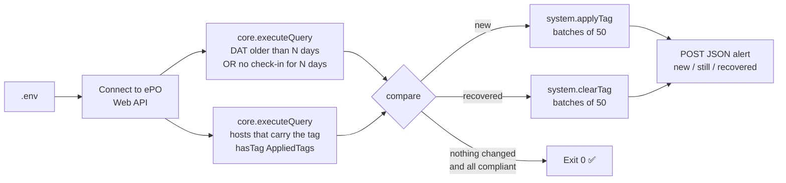

# 🛡️ Compliance Hunter

**Daily endpoint health & compliance check for Trellix ePO (formerly McAfee ePO).**
Finds endpoints with stale DAT signatures or no recent agent check-in, tags them in ePO, removes the tag again once they recover, and pushes a JSON alert (new / still / recovered) to your chat or SOAR webhook.

[](https://github.com/Murat-UGUR/compliance-hunter/actions/workflows/ci.yml)


> 🇹🇷 Türkçe özet [aşağıda](#-türkçe-özet).

---

## Why

Agents that stop updating are a quiet problem. Nothing alerts, the dashboard stays green, and the endpoint runs with week-old signatures. Compliance Hunter runs once a day and makes those endpoints **visible** (webhook alert) and **actionable** (an ePO tag you can target with policies, client tasks or queries).

Because hosts that recover are untagged automatically, the tag always means **"non-compliant right now"**, so policies, client tasks and queries that target it stay accurate.

## How it works



| Group | Meaning | Action |
|---|---|---|
| **new** | non-compliant now, not tagged yet | tag is applied |
| **still** | non-compliant now, already tagged by an earlier run | nothing (no duplicate API calls) |
| **recovered** | tagged, but compliant again | tag is cleared (`CLEAR_RECOVERED=true`, default) |

The query is sent in ePO's S-expression syntax:

```lisp
target = EPOLeafNode
select = (select EPOLeafNode.NodeName EPOComputerProperties.IPAddress
                 EPOLeafNode.LastUpdate EPOProdPropsView_VIRUSCAN.datdate)
where  = (where (or (olderThan EPOProdPropsView_VIRUSCAN.datdate 604800000)
                    (olderThan EPOLeafNode.LastUpdate        604800000)))
```

> ℹ️ `EPOLeafNode.LastUpdate` is the **last agent-to-server communication**, not the DAT date. The DAT date lives in the product properties table, which differs per product (VSE vs. ENS). That table is configurable.

## Quick start

```bash
git clone https://github.com/Murat-UGUR/compliance-hunter.git
cd compliance-hunter
pip install -r requirements.txt
cp .env.example .env        # fill in ePO URL, API user, webhook
python compliance_hunter.py --dry-run -v   # list only, changes nothing
python compliance_hunter.py                # tag + notify
```

Before the first real run, create the tag (`Outdated_DAT` by default) in **ePO → Tag Catalog**. The API can apply tags but cannot create them.

> ⚠️ **Use a tag dedicated to this tool.** With `CLEAR_RECOVERED=true` the tag is removed from every compliant host that carries it, including hosts you tagged by hand. `--dry-run` lists the hosts it would untag first.

### Configuration (`.env`)

| Variable | Required | Default | Description |
|---|:-:|---|---|
| `EPO_URL` | ✅ | | e.g. `https://epo.corp.local:8443` |
| `EPO_USERNAME` / `EPO_PASSWORD` | ✅ | | Dedicated least-privilege API account |
| `WEBHOOK_URL` | ✅ | | Slack / Teams / Mattermost / SOAR endpoint |
| `EPO_VERIFY_SSL` | | `true` | `true`, `false` or path to a CA bundle |
| `STALE_DAYS` | | `7` | Threshold in days |
| `TAG_NAME` | | `Outdated_DAT` | Tag applied to non-compliant hosts |
| `DAT_TABLE` / `DAT_DATE_COLUMN` | | `EPOProdPropsView_VIRUSCAN` / `datdate` | Change for ENS. Find the right names with `core.listTables` |
| `CLEAR_RECOVERED` | | `true` | Remove the tag from hosts that are compliant again |
| `FLAG_MISSING_DAT` | | `false` | Also flag hosts with an empty DAT date (no AV product reporting) |

### Exit codes (for cron / Task Scheduler / monitoring)

| Code | Meaning |
|:-:|---|
| 0 | Success (or nothing to do) |
| 1 | Partial failure: some tag / untag batches failed or the tagged hosts could not be read; alert still sent |
| 2 | Configuration error |
| 3 | Cannot connect or authenticate to ePO |
| 4 | Query error (check table/column names) |
| 5 | Webhook delivery failed |

### Scheduling

```cron
# every day at 08:15
15 8 * * * cd /opt/compliance-hunter && /usr/bin/python3 compliance_hunter.py >> hunter.log 2>&1
```

## Webhook payload

```json
{
  "text": "⚠️ Dikkat: 52 cihaz 7 gündür DAT güncellemesi almıyor veya ePO ile haberleşmiyor. 52 cihazda 'Outdated_DAT' etiketi var. (4 yeni, 48 önceki çalıştırmadan beri devam ediyor)\n✅ 3 cihaz düzeldi; 3 cihazdan 'Outdated_DAT' etiketi kaldırıldı.\n\n- 🆕 WS-0037 | 10.10.0.38 | ...",
  "source": "Trellix ePO Compliance Hunter",
  "count": 52,
  "tagged": 52,
  "new_count": 4,
  "still_count": 48,
  "recovered_count": 3,
  "cleared": 3,
  "recovered": ["WS-0012", "WS-0118", "WS-0140"],
  "errors": [],
  "devices": [{"hostname": "WS-0037", "ip": "10.10.0.38", "last_communication": "...", "dat_date": "...", "status": "new"}]
}
```

`text` renders directly in chat tools and lists **new** hosts first (🆕), so the daily message does not bury what changed. `devices` carries the full list for SIEM/SOAR ingestion. When every host is compliant but some recovered, an all-clear message (`✅ Tüm cihazlar uyumlu.`) is sent; when nothing is non-compliant and nothing changed, nothing is sent.

## Testing without an ePO server

The test suite spins up a **mock ePO Web API**. It handles basic auth, security tokens, `OK:`/`Error` responses, `olderThan` filtering, column validation and the tag catalog. The suite runs against a simulated 202-host fleet, so CI needs no real ePO.

```bash
pip install -r requirements-dev.txt
pytest -v
```

Covered: happy path, 50-host batching, dry-run, missing tag, partial batch failure, wrong password, unreachable server, missing config, wrong column, webhook failure, `.env` overrides, and the tag lifecycle: new / still / recovered classification, clearing recovered hosts in batches, all-clear message, `CLEAR_RECOVERED=false`, `FLAG_MISSING_DAT`, a failed clear batch, and a failed tagged-hosts query (which must never clear anything).

CI runs the suite on Linux (Python 3.10–3.13) and on Windows.

## Known limitations

- Hosts **without** the AV product report an empty DAT date and are only caught by the check-in condition. Set `FLAG_MISSING_DAT=true` to flag them too (adds `(isBlank <DAT column>)` to the query).
- Not yet validated against a live ePO server: the tag lifecycle uses `system.clearTag` and the `hasTag` query operator on `EPOLeafNode.AppliedTags`, which are tested against the mock only. Run with `--dry-run -v` first.
- Table and column names vary between ePO / ENS versions. Verify them with `https://<epo>:8443/remote/core.listTables` before the first run.

## 🇹🇷 Türkçe özet

Trellix ePO'da **N gündür DAT güncellemesi almamış** veya **ePO ile haberleşmemiş** cihazları bulur, onlara `Outdated_DAT` etiketini atar, **düzelen cihazlardan etiketi kaldırır** ve listeyi (yeni / devam eden / düzelen) JSON olarak Webhook'a gönderir. Böylece etiket her zaman "şu an uyumsuz" anlamına gelir. Etiketi yalnızca bu araç için kullanın; `CLEAR_RECOVERED=false` ile kaldırma kapatılabilir. İlk çalıştırmada `--dry-run` kullanın. Etiketi önceden ePO Tag Catalog'da oluşturun. ENS kullanıyorsanız `DAT_TABLE` ve `DAT_DATE_COLUMN` değerlerini `core.listTables` çıktısına göre ayarlayın.

## License

MIT © Murat UĞUR
